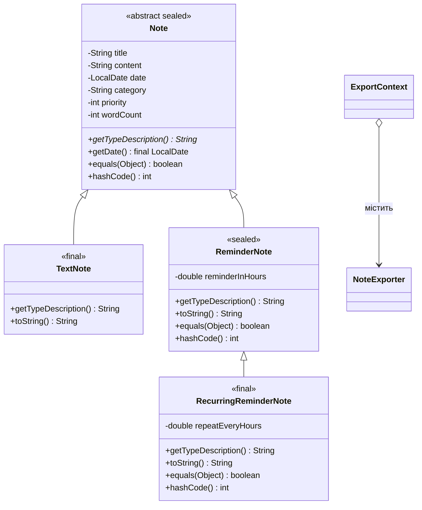

# Personal Notes

Консольний Java-застосунок для створення, пошуку, перегляду, сортування та експорту персональних нотаток.

## Предметна область

Усі об'єкти моделі є нотатками. Спільні для них назва, текст, дата створення, категорія, пріоритет і кількість слів зберігаються в абстрактному класі `Note`. Різні способи нагадування задаються підкласами.

| Клас | Зв'язок | Власні дані |
| --- | --- | --- |
| `Note` | Абстрактна sealed-основа | `title`, `content`, `date`, `category`, `priority`, `wordCount` |
| `TextNote` | Звичайна нотатка є різновидом `Note` | Нагадування відсутнє |
| `ReminderNote` | Нотатка з нагадуванням є різновидом `Note` | `reminderInHours` |
| `RecurringReminderNote` | Повторюване нагадування є різновидом `ReminderNote` | `repeatEveryHours` |

Перевірка «є різновидом» проходить для цих зв'язків: кожен підклас можна зберегти в змінній типу `Note`, а `RecurringReminderNote` — також у змінній `ReminderNote`. Натомість `ExportContext` не є експортером: він містить `NoteExporter`, тому це композиція («має»).

## Діаграма класів



## ЛР6: наслідування та поліморфізм

### Базовий рівень

- `Note` містить спільний стан і поведінку. Його поля приватні й незмінні після створення.
- `TextNote` та `ReminderNote` — два різні безпосередні підкласи `Note`. `RecurringReminderNote` успадковує поведінку `ReminderNote` і додає інтервал повторення.
- Конструктори підкласів викликають `super(...)`. Перевантажені конструктори делегують через `this(...)`, щоб централізувати підрахунок слів і ініціалізацію.
- Кожен конкретний тип перевизначає `getTypeDescription()` і `toString()`; `toString()` додає специфічні дані до `super.toString()`.
- `Main.notes` має тип `Note[]`. `printNotes()` проходить по цьому масиву та показує результат поліморфного виклику `getTypeDescription()`.

### Абстрактний клас і конструктори

`Note` абстрактний, бо конкретна нотатка має бути звичайною, з нагадуванням або з повторюваним нагадуванням. Абстрактний `getTypeDescription()` змушує кожен тип визначити власну назву. Базовий конструктор все одно потрібен: він ініціалізує спільні поля.

Під час створення `RecurringReminderNote` конструктори виконуються в порядку `Note` → `ReminderNote` → `RecurringReminderNote`. Кожен друкує повідомлення `[constructor] ...`; запустіть програму й додайте повторюване нагадування, щоб побачити порядок.

`Note.getDate()` позначений `final`: підкласи не повинні змінювати правило отримання дати створення нотатки. Сам `Note` запечатаний, а `TextNote` та `RecurringReminderNote` — фінальні.

### Поліморфізм, типи та `sealed`

У `Main.buildNote(...)` обирається `TextNote`, `ReminderNote` або `RecurringReminderNote`. У `printNotes()` змінна циклу має статичний тип `Note`, а її фактичний тип залежить від створеного об'єкта. Виклик `getTypeDescription()` обирає реалізацію за фактичним типом. Через `Note` не можна напряму викликати `getRepeatEveryHours()`, тому застосовано `instanceof RecurringReminderNote recurring`.

`Note` оголошений як `sealed` з прямими підкласами `TextNote` і `ReminderNote`; останній дозволяє тільки `RecurringReminderNote`. Вичерпний `switch` у `Main.describeNote()` обробляє кожен дозволений варіант. Якщо дозволені типи зміняться, компілятор допоможе знайти неповний `switch`.

### Рівність об'єктів

`Note.equals()` перевіряє точний клас через `getClass()` і порівнює назву, текст, категорію, пріоритет і кількість слів. Дату створення не порівнюю, щоб пошук зразка з попередніх лабораторних залишався можливим у наступні дні. `ReminderNote` і `RecurringReminderNote` додають до порівняння власні поля; `hashCode()` обчислюється з тих самих даних. Це зберігає симетрію: об'єкти різних типів не вважаються рівними ні в одному напрямку.

Наприклад, для `TextNote text` і `ReminderNote reminder`:

```java
text.equals(reminder);   // false: класи різні
reminder.equals(text);   // false: класи різні
```

Якби базовий клас використовував `instanceof Note`, а підклас додавав власні поля у `equals()`, порівняння могло б бути асиметричним. `getClass()` гарантує рівність лише об'єктів одного конкретного класу; `instanceof` допускає порівняння з підкласами й вимагає особливої уваги до симетрії.

### Композиція

`ExportContext` містить поле типу `NoteExporter` і делегує йому експорт. Контекст не є експортером — він використовує його, тож композиція відповідає зв'язку «має». Наслідування тут порушило б зміст: контекст не повинен підміняти об'єкт, що форматує експорт.

## ЛР4: інтерфейси та Strategy

- `NoteExporter` описує контракт експорту; `PlainTextExporter` і `CsvExporter` реалізують різні формати.
- `AbstractNoteExporter` містить спільну реалізацію `exportAll()`. `CsvExporter` додає заголовок і делегує формування рядків методу `super.exportAll()`.
- `ExportContext` зберігає стратегію в `NoteExporter` та може змінювати її через `setExporter()`.

## Структура проєкту

```text
src/com/eugene/notesapp/
├── Main.java
├── model/
│   ├── Note.java
│   ├── TextNote.java
│   ├── ReminderNote.java
│   └── RecurringReminderNote.java
├── exception/
├── export/
└── ui/state/
```

## Запуск

Потрібна Java 25 або новіша.

```powershell
cd src
javac -encoding UTF-8 com/eugene/notesapp/Main.java
java -Dfile.encoding=UTF-8 com.eugene.notesapp.Main
```

Або запустіть `run.bat` з кореня репозиторію.
