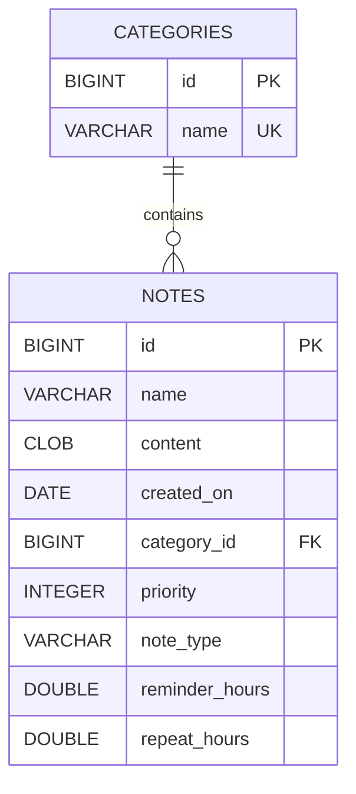

# Personal Notes — ЛР №11: Hibernate ORM та Jakarta Persistence

**Високий рівень (1–3).** Третя реалізація `NoteService`: Hibernate додається до наявних сховищ на колекціях і JDBC. Усі три використовують незмінні інтерфейси ЛР №7. Hibernate і JDBC працюють із тими самими таблицями та файловою H2.

## Підготовка до захисту

- [Розбір обох робіт із визначеннями, кодом, прикладами й тренуванням](docs/DEFENSE.md).
- [Усі 45 відповідей до ЛР №10: Maven/JDBC](docs/QA-LR10.md).
- [Усі 26 відповідей до ЛР №11: Hibernate/JPA](docs/QA-LR11.md).

## Доступ до двох лабораторних

| Робота | Окрема гілка | Доступ у цій гілці |
| --- | --- | --- |
| ЛР №10, Maven/JDBC | [`lr10/maven-jdbc`](https://github.com/YevheniyDeriy/Java-course/tree/lr10/maven-jdbc), [PR #9](https://github.com/YevheniyDeriy/Java-course/pull/9) | Усі JDBC-класи, `JdbcDemo`, `BatchBenchmark`, меню з `notes.storage=jdbc` |
| ЛР №11, Hibernate | `lr11/hibernate-notes` | ORM-класи, `HibernateDemo`, `OrmPitfallsDemo`, `SchemaValidationDemo`, меню з `notes.storage=hibernate` |

Нова гілка створена **від `lr10/maven-jdbc`**, тому працює до злиття попереднього PR. Гілка попередньої роботи збережена на коміті `db77c74`; її PR не змінюється. Повний опис JDBC-лабораторної та її вимірювань — у [docs/LR10.md](docs/LR10.md).

Обидва PR мають ціль `main`. Рекомендований порядок злиття: **спочатку PR #9 (ЛР №10), потім PR ЛР №11**. До першого злиття diff нового PR включатиме також успадковані зміни ЛР №10; після звичайного merge PR #9 GitHub покаже лише додаток Hibernate. Якщо попередній PR буде squash/rebase-merged, перед злиттям наступного слід оновити його гілку від `main` і перевірити diff. Злиття автоматично не виконується.

Для окремого перегляду версій:

```powershell
git switch lr10/maven-jdbc   # лише попередня робота
git switch lr11/hibernate-notes  # обидві роботи разом
```

## Запуск

Потрібна **повна JDK 25+**, доступна через `JAVA_HOME`, і інтернет при першому завантаженні Maven/залежностей. Maven Wrapper 3.9.11 уже включено. На Linux/macOS використовуйте `./mvnw` замість `.\mvnw.cmd`.

```powershell
git switch lr11/hibernate-notes
.\mvnw.cmd compile
.\mvnw.cmd exec:java
.\mvnw.cmd clean verify
```

Типовий `exec:java` запускає **HibernateDemo без введення**: створення, читання, оновлення, видалення, JPQL-сортування, пошук за категорією, пагінація та читання ORM-зміни через JDBC. Демо прибирає лише власні записи. Наявні нотатки залишаються у БД.

```powershell
# Попередня лабораторна — JDBC:
.\mvnw.cmd exec:java '-Dexec.mainClass=com.eugene.notesapp.JdbcDemo'
.\mvnw.cmd exec:java '-Dexec.mainClass=com.eugene.notesapp.BatchBenchmark'

# Нова лабораторна — відтворення та виправлення проблем ORM:
.\mvnw.cmd exec:java '-Dexec.mainClass=com.eugene.notesapp.OrmPitfallsDemo'
.\mvnw.cmd exec:java '-Dexec.mainClass=com.eugene.notesapp.SchemaValidationDemo'

# Те саме меню, вибір реалізації лише параметром запуску:
.\mvnw.cmd exec:java '-Dexec.mainClass=com.eugene.notesapp.Main' '-Dnotes.storage=hibernate'
.\mvnw.cmd exec:java '-Dexec.mainClass=com.eugene.notesapp.Main' '-Dnotes.storage=jdbc'
.\mvnw.cmd exec:java '-Dexec.mainClass=com.eugene.notesapp.Main' '-Dnotes.storage=memory'
```

Для меню типова реалізація в цій гілці — Hibernate. `memory` зберігає дані лише до завершення процесу. `hibernate` і `jdbc` використовують одну БД, тож можна додати нотатку одним способом, завершити програму й прочитати іншим. Навчальний файловий режим і генератор id розраховані на **один процес застосунку за раз**.

### Порожня БД, конфігурація та збереження даних

При першому старті файл `data/notes.mv.db` створюється автоматично. `DBConnection` виконує **незмінений** `src/main/resources/init.sql` з ЛР №10. Після цього `JpaUtil` створює `EntityManagerFactory`, а Hibernate **лише перевіряє** схему (`validate`). Hibernate не створює/не змінює таблиці. Окремий сервер БД не потрібен.

Параметри залишаються в `application.properties`; змінні оточення мають пріоритет:

```powershell
$env:NOTES_DB_URL = 'jdbc:h2:file:./data/lr11-empty'
$env:NOTES_DB_USER = 'sa'
$env:NOTES_DB_PASSWORD = ''
.\mvnw.cmd exec:java
```

Ця команда демонструє запуск на окремій порожній БД без видалення попередньої. Щоб повернутися до типового `./data/notes`, видаліть змінні оточення у своєму терміналі або відкрийте новий термінал. Справжні паролі передавайте через оточення; `data/`, `target/` та файли БД виключені з Git.

`src/main/resources/META-INF/persistence.xml` містить **один** persistence-unit `notes-pu`, RESOURCE_LOCAL, Hibernate provider, явний список двох сутностей, `show_sql=true`, `format_sql=true`, `hbm2ddl.auto=validate`. DataSource передається програмно з того самого Hikari-пулу, що й для JDBC; реквізити не дублюються в XML. Діалект Hibernate визначає з JDBC metadata. Статистика ввімкнена для вимірювання N+1, кеш другого рівня вимкнений.

Версії зафіксовано в `pom.xml`: **Hibernate ORM 7.4.14.Final**, Jakarta Persistence 3.2 (транзитивно), **SLF4J 2.0.20**, H2 2.3.232 (драйвер попередньої роботи), HikariCP 6.3.0. Версію Hibernate звірено з [офіційною стабільною серією 7.4](https://hibernate.org/orm/releases/7.4/), SLF4J — з Maven Central. Явний `slf4j-api` узгоджує версію зі `slf4j-simple` і перекриває стару транзитивну версію HikariCP. Перегляд: `mvn dependency:tree`.

Якщо системна Java повідомляє `release version 25 not supported`, виберіть повну JDK 25 через `JAVA_HOME` (каталог JDK, без `bin`). Локальні перевірки виконані на Temurin 25.0.5; системна Java не змінюється.

## Об'єктна модель і схема



У ЛР №7 доменні `Note`, `TextNote`, `ReminderNote`, `RecurringReminderNote` незмінні, частина класів sealed/final, id призначається до `save`, а `save` повертає void. Щоб зберегти цю модель та сумісність JDBC, додано **окремі ORM-представлення тієї самої предметної області**:

- `orm.entity.BaseEntity` — `@MappedSuperclass`, спільні `Long id` і `String name`, `@Id`, `@GeneratedValue`, `@Column`.
- `CategoryRecord` — нефінальна `@Entity`, таблиця `categories`, захищений конструктор без параметрів.
- `NoteRecord` — нефінальна `@Entity`, таблиця `notes`, захищений конструктор без параметрів.
- `NoteMapper` переносить поля між ORM-представленням і незмінними доменними об'єктами **поки EntityManager відкритий**.

`HibernateNoteService implements NoteService`, `HibernateCategoryService implements CRUDService<Category>`. Інтерфейси `CRUDService` і `NoteService` не змінювалися. Мапінг відновлює всі підтипи нотаток, первинну дату та параметри повторення. `NoteType` зберігається через `@Enumerated(EnumType.STRING)`; `@JdbcTypeCode(VARCHAR)` зберігає сумісність із наявним `VARCHAR(16)`, а не H2 ENUM. `getWordCount()` — `@Transient`, оскільки це похідне значення.

`@Column(nullable=false, length=255/16)` відповідає DDL; content — `@Lob`/CLOB, дата — LocalDate/DATE. Грошових полів немає, тому precision/scale не застосовуються: для грошей були б `BigDecimal` і NUMERIC. CHECK пріоритету та узгодженості нагадувань, PK, UNIQUE категорії, FK і **ON DELETE RESTRICT** залишаються відповідальністю незміненого `init.sql`.

### Генерація id та equals/hashCode

Попередня схема має звичайні BIGINT PK без identity/sequence; її не можна змінювати за умовою. Тому `@GeneratedValue` доповнено типовою для Hibernate точкою розширення `@CourseGeneratedId` (`@IdGeneratorType`) та `CourseIdGenerator implements BeforeExecutionGenerator`:

- для нової ORM-сутності з null id генерується значення через той самий `BaseEntity.nextId()`, що й у доменних конструкторів;
- для `save` доменного об'єкта з уже призначеним id генератор зберігає його (`allowAssignedIdentifiers=true`);
- перед створенням production EMF `DBConnection` читає максимальний id обох таблиць і резервує діапазон, як у ЛР №10.

Це **генерація в Java, не IDENTITY/SEQUENCE**: вона обрана для незмінених контракту й схеми. `IDENTITY` потребувала б identity-колонки, `SEQUENCE` — послідовності, `TABLE` — додаткової таблиці, UUID — іншого типу ключа. Для кількох процесів потрібен генератор на боці БД і відповідна міграція. SPI `@IdGeneratorType` та підтримка призначених значень описані в [Hibernate Generator API](https://docs.hibernate.org/orm/7.4/javadocs/org/hibernate/generator/Generator.html).

ORM `equals`: однаковий фактичний тип сутності та однаковий **ненульовий** id; дві нові сутності з null id не рівні. Proxy-клас визначається без завантаження зв'язків. `hashCode` сталий для типу сутності, тож не змінюється після генерації id і не ламає HashSet. Тести перевіряють симетрію з detached proxy та незмінність hashCode. Доменна рівність із ЛР №7 залишається окремим контрактом за id. У `toString` немає зв'язків, щоб уникнути рекурсії й неявних SQL-запитів.

## Зв'язки та життєвий цикл

`NoteRecord.category` — **власник** зв'язку: `@ManyToOne(fetch=LAZY, optional=false)`, `@JoinColumn(name="category_id", nullable=false)`. FK фізично знаходиться в `notes`, тому саме зміна цієї сторони визначає UPDATE. `CategoryRecord.notes` — зворотна сторона: `@OneToMany(mappedBy="category", fetch=LAZY)`.

`CategoryRecord.addNote/removeNote` та `NoteRecord.setCategory` підтримують обидві сторони. Колекція ззовні доступна лише для читання. Перенесення до іншої категорії прибирає нотатку зі старої та додає до нової.

Для `CategoryRecord.notes` обрано `cascade={PERSIST, MERGE}`, **orphanRemoval=false**: можна зберегти новий граф і змерджити його, але видалення категорії/елемента колекції не повинно мовчки видаляти нотатку. `REMOVE` не задано з жодної сторони; БД захищає дітей через RESTRICT. Оскільки FK NOT NULL, після `removeNote` нотатку слід призначити іншій категорії до flush або явно видалити через EntityManager. Саме видалення з колекції не є операцією видалення з БД.

`JpaUtil` — лінивий потокобезпечний Singleton (holder). Важкий `EntityManagerFactory` створюється один раз, для кожного `read`/`inTransaction` створюється окремий EntityManager, який закривається try-with-resources. Обидва методи використовують коротку транзакцію; виняток запускає rollback. Операції повертають доменні значення або свідомо завантажені ORM-графи. Тести/ізольовані демо використовують окремі scoped-фабрики через `JpaUtil.open(DataSource)`, не production БД.

`save` шукає сутність за id: нову передає до `persist`, наявну змінює у managed-стані — UPDATE виконує dirty checking при commit. `findById` кидає власний `EntityNotFoundException`, як у ЛР №7. `delete` зберігає попередній контракт: true при видаленні, false для відсутнього id; наступний `findById` кидає виняток. Це дозволяє старому меню працювати без зміни сценаріїв.

Тест життєвого циклу показує transient → managed після persist → detached після закриття EntityManager. Зміна detached-об'єкта не записується сама. `merge` повертає **іншу managed-копію**, тоді як переданий об'єкт залишається detached. `remove` переводить керовану сутність у removed-стан.

## JPQL і пагінація

У `HibernateNoteService` використовуються константні JPQL-запити з іменованими параметрами:

```java
TypedQuery<NoteRecord> query = manager.createQuery(
        "select n from NoteRecord n join fetch n.category c where c.name = :category order by n.name, n.id",
        NoteRecord.class);
query.setParameter("category", categoryName);
```

У коді кожний запит — один фіксований літерал. Введення користувача не додається до тексту. `findByCategory` і `findByName` перевірені з payload `' OR '1'='1' --`: він є значенням, а не частиною JPQL.

`findAllSortedByNameAndByPriority` виконує `ORDER BY n.name, n.priority, n.id` у БД. `findPage(limit, offset)` використовує **setFirstResult/setMaxResults** з порядком `(name, id)`; limit 1..1000, offset 0..Integer.MAX_VALUE. To-one `join fetch n.category` не множить рядки нотаток і сумісний із цією пагінацією.

Для **collection JOIN FETCH** слід враховувати версію Hibernate. У старіших версіях пагінація часто виконувалась у пам'яті; пряме обмеження рядків JOIN могло б обрізати колекцію. Починаючи з Hibernate 7.4, на підтримуваних діалектах (зокрема H2) обмеження батьків переноситься в SQL-підзапит, після якого приєднуються всі діти. Окремий перевірочний запуск на нашій 7.4.14.Final з `setMaxResults(1)` повернув 1 категорію з 2 нотатками за 1 SQL-запит, навіть із налаштованим `fail_on_pagination_over_collection_fetch=true`: цей прапорець не забороняє безпечний SQL-випадок. Поведінку 7.4 описано в [офіційному migration guide](https://docs.hibernate.org/orm/7.4/migration-guide/#limits-and-fetch-joins). Для переносимості між версіями/провайдерами можна використовувати два запити: сторінка id категорій, потім JOIN FETCH за цими id. Наш N+1-демо не використовує пагінацію.

## LazyInitializationException та N+1 — відтворення і виправлення

`OrmPitfallsDemo` створює окрему H2 in-memory, виконує **той самий init.sql**, запускає фабрику з validate і зберігає **3 категорії, по 2 нотатки**. Користувацькі файли не змінюються.

1. Звичайний запит повертає категорію; EntityManager закривається; `category.getNotes().size()` кидає **LazyInitializationException**. Виняток очікується й перевіряється.
2. Запит `LEFT JOIN FETCH c.notes` завантажує потрібну колекцію всередині операції. Після закриття EntityManager доступ до 2 нотаток успішний. Переведення всіх зв'язків у EAGER не використовується.
3. У новому EntityManager завантажуються 3 категорії й у циклі читаються їхні колекції — **1 + 3 = 4 SQL-запити**.
4. Запит `select distinct c from CategoryRecord c left join fetch c.notes ...` повертає ті самі 6 нотаток за **1 SQL-запит**.

Фактичний результат локального запуску 04.11.2026:

```text
LazyInitializationException reproduced after EntityManager.close().
Lazy fix: JOIN FETCH; detached category exposes 2 loaded notes.
N+1: 3 categories, 6 notes; SQL statements: 4 -> 1
PASS: LazyInitializationException and N+1 reproduced and fixed.
```

Числа зчитуються з `Statistics.getPrepareStatementCount()` після `clear()` перед кожним способом, а не записані як очікуваний текст. Підготовка даних та попередня lazy-демонстрація не входять у вимірювання; кожен спосіб має новий EntityManager, кеш другого рівня вимкнений. Тест вимагає рівно 4 і 1 запит та однакові 6 нотаток.

## Демонстрація помилки validate

`SchemaValidationDemo` працює на окремій in-memory БД. Спочатку правильна модель проходить validate на init.sql. Потім запускається свідомо неправильна демонстраційна сутність `BrokenNoteMapping`: у ній `@Column(name="name")` замінено на **`@Column(name="name_typo")`**. Hibernate повідомляє:

```text
Schema validation: missing column [name_typo] in table [notes]
```

Цей клас виключений із production persistence-unit (`exclude-unlisted-classes=true`) і використовується лише окремим bootstrap у демо/тесті. Після очікуваної помилки правильна модель знову проходить validate, що підтверджує відсутність змін схеми. Для наочного експерименту можна також тимчасово змінити реальний `@Column` у `NoteRecord`, запустити `compile exec:java`, побачити збій і повернути анотацію.

`validate` перевіряє наявність таблиць/колонок і сумісність типів, але **не є повним порівнянням DDL**: не слід покладатися на нього для всіх length/nullable/UNIQUE/CHECK та інших деталей. Саме тому демонструється відсутня колонка, а обмеження перевіряються інтеграційними тестами та підтримуються init.sql. `update/create/create-drop` в основному застосунку не використовуються.

## Структура та перевірки

```text
src/main/java/com/eugene/notesapp/
  Main, JdbcDemo, BatchBenchmark                       # ЛР10 збережено
  HibernateDemo, OrmPitfallsDemo, SchemaValidationDemo  # ЛР11
  service/NoteServices, HibernateNoteService, HibernateCategoryService
  service/Jdbc*, InMemory*, CRUDService, NoteService
  orm/JpaUtil, NoteMapper
  orm/entity/BaseEntity, CategoryRecord, NoteRecord, NoteType
  orm/entity/CourseGeneratedId, CourseIdGenerator
  orm/demo/OrmPitfalls, BrokenNoteMapping
src/main/resources/
  application.properties, init.sql                     # схема ЛР10 без змін
  META-INF/persistence.xml
src/test/java/com/eugene/notesapp/
  CrudServiceTest, JdbcServiceTest, HibernateServiceTest
docs/LR10.md
```

**27 тестів**: 13 попередніх плюс 14 ORM-перевірок. Охоплено CRUD, сумісність JDBC ↔ ORM, усі типи нотаток і дати, JPQL та ін'єкцію як дані, пагінацію, генерацію id, каскадне збереження графа, допоміжні методи, RESTRICT, equals/hashCode та proxy, rollback, закриття EntityManager, detached/merge, lazy/N+1, помилковий @Column, повторне відкриття файлової БД. Тести мають власні in-memory/тимчасові БД.

Локально 04.11.2026 на Temurin 25.0.5: `clean verify` — **27 тестів, 0 помилок**, усі чотири демо — **PASS**. Окремо перевірено реальне меню в різних JVM: JDBC створює першу нотатку, Hibernate — другу в тому самому файлі, наступний запуск JDBC бачить обидві без зіткнення id; режим memory запускається порожнім незалежно від них.

```powershell
.\mvnw.cmd clean verify
.\mvnw.cmd exec:java
.\mvnw.cmd exec:java '-Dexec.mainClass=com.eugene.notesapp.JdbcDemo'
.\mvnw.cmd exec:java '-Dexec.mainClass=com.eugene.notesapp.OrmPitfallsDemo'
.\mvnw.cmd exec:java '-Dexec.mainClass=com.eugene.notesapp.SchemaValidationDemo'
```

GitHub Actions виконує verify та всі чотири демо на Java 25. Залишено попередній Maven Wrapper, UTF-8 і правила виключення файлів БД. Дата першої пари невідома; дедлайн — два тижні від неї, усний захист складає студент.
