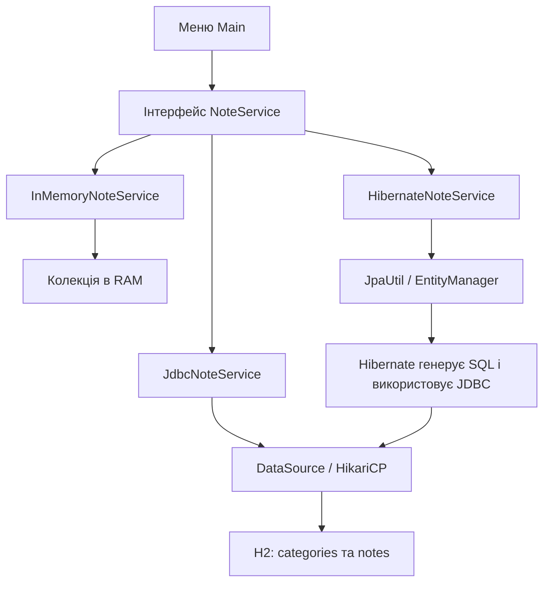
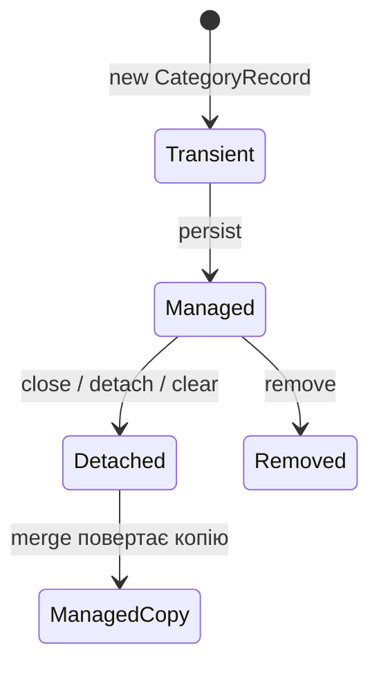

# Як зрозуміти й захистити ЛР №10 та ЛР №11

Це посібник саме до твого коду. Мета — уміти пояснити, **що відбувається з однією нотаткою**, а потім застосувати цю історію до будь-якого контрольного запитання.

- [45 контрольних запитань до Maven/JDBC — повні відповіді](QA-LR10.md).
- [26 контрольних запитань до Hibernate/JPA — повні відповіді](QA-LR11.md).
- [Документація ЛР №10](LR10.md) · [Запуск обох робіт](../README.md).

**Як читати:** спочатку пройди частини 1–8 із цим посібником, потім запусти демо, далі відповідай на контрольні запитання без підглядання. Не вчи напам'ять 71 абзац: будуй відповідь як «визначення → навіщо → мій приклад → важлива деталь».

## 1. Одна історія, яка об'єднує обидві лабораторні

Ти пишеш застосунок персональних нотаток. Користувач додає «Підготуватися до захисту», категорію «Навчання», текст і пріоритет. Меню має зберегти нотатку, знайти її за id, оновити або видалити.

У ЛР №7 нотатки зберігалися в колекції Java. Коли процес завершився, пам'ять зникла. **ЛР №10 переносить дані у файлову БД через JDBC. ЛР №11 додає інший спосіб працювати з тією самою БД — Hibernate ORM.**

| Спосіб | Що пише розробник | Де зберігаються дані |
| --- | --- | --- |
| InMemory | операції з Map/колекціями | RAM процесу |
| JDBC | SQL, параметри, читання ResultSet | H2, файл на диску |
| Hibernate | mapping сутностей, робота EntityManager, JPQL | та сама H2, той самий файл |



**Головна думка для захисту:** «Я зберіг контракт сервісу, а спосіб зберігання виніс у різні реалізації».

## 2. Мінімальний словник без складних слів

| Термін | Визначення | У твоєму проєкті |
| --- | --- | --- |
| База даних | організоване сховище даних із правилами читання та запису | файл H2 |
| СУБД | програма, що керує БД, запитами, транзакціями й обмеженнями | H2 |
| Реляційна таблиця | рядки об'єктів та колонки їхніх властивостей | notes, categories |
| Сутність | об'єкт предметної області з ідентичністю | нотатка або категорія |
| id | ідентифікатор конкретного об'єкта/рядка | BIGINT / Java long |
| PK | первинний ключ, який однозначно визначає рядок | notes.id |
| FK | зовнішній ключ, посилання на рядок іншої таблиці | notes.category_id |
| SQL | мова роботи з реляційною БД | SELECT, MERGE, UPDATE, DELETE |
| DDL | SQL-опис структури | CREATE TABLE у init.sql |
| DML | SQL-зміна даних | INSERT/UPDATE/DELETE/MERGE |
| CRUD | Create, Read, Update, Delete | save, findById/findAll, delete |
| JDBC | стандартний Java API доступу до реляційної БД | java.sql |
| ORM | відображення об'єктів і зв'язків на таблиці й ключі | Hibernate mapping |
| JPA | специфікація Jakarta Persistence | EntityManager, @Entity |
| Hibernate | реалізація JPA та додаткові ORM-можливості | hibernate-core |
| JPQL | запити до сутностей та Java-атрибутів | from NoteRecord n |
| Транзакція | група дій з одним підсумковим commit/rollback | перенесення категорії |
| Mapping | правила відповідності класів/полів таблицям/колонкам | @Table, @Column, @JoinColumn |
| Persistence context | набір сутностей, за якими зараз стежить EntityManager | managed NoteRecord |
| Proxy | представник об'єкта, який може завантажити його пізніше | lazy категорія |
| Flush | синхронізація змін ORM-об'єктів із SQL у транзакції | UPDATE перед commit |
| Commit | підтвердження транзакції | зміни залишаються |
| Rollback | скасування її непідтверджених змін | відкат після UNIQUE-помилки |

**Важлива база:** Java-об'єкт і SQL-рядок — два представлення даних. Об'єкт може бути створений, але ще не записаний; рядок може існувати, хоча відповідного об'єкта зараз немає в RAM.

## 3. Розуміємо таблиці на маленькому прикладі

Це навчальні значення для пояснення, а не команда зміни твоєї БД.

**categories:**

| id | name |
| ---: | --- |
| 10 | Навчання |
| 20 | Архів |
| 30 | Робота |

**notes, скорочено:**

| id | name | priority | category_id |
| ---: | --- | ---: | ---: |
| 101 | План | 5 | 10 |
| 102 | Захист | 2 | 10 |
| 103 | План | 1 | 10 |

Одна категорія 10 має три нотатки. Кожна нотатка має одну категорію. Це **1:N**, або з боку нотатки **N:1**. Два рядки можуть мати назву «План», але id у них різні: назва — властивість, id — ідентичність.

Щоб отримати назву категорії разом із нотаткою, JDBC виконує JOIN:

```sql
SELECT n.id, n.name, c.name AS category_name
FROM notes n
JOIN categories c ON c.id = n.category_id;
```

JOIN зіставляє рядки за FK. У Java доменна Note з попередніх робіт має рядкову категорію, тому JDBC mapRow читає category_name із JOIN. ORM NoteRecord натомість має посилання CategoryRecord.

Схема містить правила:

```sql
priority INTEGER NOT NULL CHECK (priority BETWEEN 1 AND 5),
category_id BIGINT NOT NULL,
FOREIGN KEY (category_id) REFERENCES categories(id) ON DELETE RESTRICT
```

- NULL — відсутнє значення, а не порожній рядок чи 0.
- Пріоритет 9 не пройде CHECK.
- Категорія 999, якої немає, не пройде FK.
- Видалення категорії 10, поки є діти, не пройде RESTRICT.
- Дубль назви категорії не пройде UNIQUE.

Ці правила захищають дані незалежно від того, через JDBC чи ORM виконаний запис.

## 4. Чому меню однакове: інтерфейс і generics

Ключова частина [CRUDService](../src/main/java/com/eugene/notesapp/service/CRUDService.java):

```java
public interface CRUDService<T extends BaseEntity> {
    T findById(long id);
    void save(T entity);
    boolean delete(long id);
    List<T> findAll();
}
```

**Interface** описує, які операції доступні. **Implements** означає, що клас зобов'язується їх надати. **T** — параметр типу; `T extends BaseEntity` вимагає, щоб об'єкт мав спільну основу з id/name. Для NoteService цей T — Note.

```java
NoteService service = new JdbcNoteService();
// Або new InMemoryNoteService(), або new HibernateNoteService().
service.save(note);
Note loaded = service.findById(note.getId());
```

Клієнт бачить NoteService, тому код викликів не залежить від конкретного сховища. NoteServices вибирає реалізацію за `notes.storage`. Цю точку збирання залежностей називають **composition root**.

Семантика контракту:

- save нового id додає; save наявного id оновлює; кількість не повинна зростати при звичайному оновленні.
- findById існуючого id повертає об'єкт, відсутнього — кидає наш `com.eugene.notesapp.exception.EntityNotFoundException`.
- delete наявного id дає true, повторного видалення — false.
- save повертає void, id доменного об'єкта вже визначений до збереження.

Цей власний EntityNotFoundException — інший клас, ніж однойменний `jakarta.persistence.EntityNotFoundException`. Наш Hibernate-сервіс явно зберігає попередній контракт.

## 5. ЛР №10: Maven і запуск

**Maven** — інструмент збирання та залежностей. У pom.xml вказано Java, UTF-8, бібліотеки, тести й точку запуску. **Wrapper** — скрипти mvnw/mvnw.cmd, які отримують визначену версію Maven, тому глобальний mvn не обов'язковий.

```text
src/main/java       — код застосунку
src/main/resources  — properties, SQL, persistence.xml
src/test/java       — тести
target              — результат збирання, не джерела
data                — локальна файлова БД, не результат компіляції
```

Команди треба розуміти:

```powershell
.\mvnw.cmd compile       # компілює основний код і готує ресурси
.\mvnw.cmd test          # також компілює й запускає тести
.\mvnw.cmd package       # також створює JAR
.\mvnw.cmd clean verify  # чисте збирання та перевірки до verify
.\mvnw.cmd exec:java     # запускає налаштований main; перед цим потрібна компіляція
```

У **гілці ЛР №10** default exec:java — JdbcDemo. У **спільній гілці ЛР №11** — HibernateDemo. Це налаштування exec.mainClass у POM, а не зникнення попереднього демо. Для JDBC у новій гілці передай повне ім'я класу.

## 6. ЛР №10: звідки береться Connection

Читай [DBConnection](../src/main/java/com/eugene/notesapp/db/DBConnection.java) у такій послідовності:

1. Читає application.properties.
2. Для URL/user/password перевіряє, чи є відповідні змінні оточення.
3. Створює HikariDataSource — пул з'єднань.
4. Виконує init.sql.
5. Читає MAX(id) обох таблиць, щоб продовжити спільний лічильник Java-id після перезапуску.
6. Надає getDataSource/getConnection.

**Singleton** тут — один власник пулу. **DataSource** — об'єкт, з якого можна отримати Connection. **Pool** — набір з'єднань для повторного використання.

```java
private static final class Holder {
    private static final DBConnection INSTANCE = new DBConnection();
}
```

Це ліниве створення: поки Holder не знадобився, ресурси не створюються. Потокобезпечність створення гарантує ініціалізація класів JVM.

**Не змішуй три close:** ResultSet.close звільняє результат; Connection.close у Hikari повертає позичене з'єднання; HikariDataSource.close завершує пул.

## 7. ЛР №10: читаємо одну нотатку покроково

У [AbstractJdbcCrudService](../src/main/java/com/eugene/notesapp/service/AbstractJdbcCrudService.java) спільна схема читання виглядає так (скорочено):

```java
try (Connection connection = dataSource.getConnection();
     PreparedStatement statement = connection.prepareStatement(sql)) {
    parameters.bind(statement);
    try (ResultSet rows = statement.executeQuery()) {
        List<T> result = new ArrayList<>();
        while (rows.next()) {
            result.add(mapRow(rows));
        }
        return result;
    }
}
```

Пояснення кожного кроку:

1. **Connection** — сесія доступу до БД; позичаємо її в пулі.
2. **PreparedStatement** — SQL-шаблон із параметрами.
3. **Bind** — запис значень у `?` через setLong/setString тощо; індексація від 1.
4. **ExecuteQuery** виконує читання та дає ResultSet.
5. **ResultSet** — результат із курсором; next пересуває курсор на рядок.
6. **MapRow** перетворює колонки поточного рядка на Java-об'єкт.
7. Try-with-resources закриває все навіть при помилці.

Наприклад, findById(101) додає до контрольованого SQL-шаблону `WHERE e.id = ?`, задає 101 і отримує список з одним результатом або порожній. Порожній результат перетворюється на власний EntityNotFoundException. Користувацький id не склеюється із SQL.

[JdbcNoteService.mapRow](../src/main/java/com/eugene/notesapp/service/JdbcNoteService.java) читає note_type та створює потрібний підклас:

```text
TEXT       → TextNote
REMINDER   → ReminderNote
RECURRING  → RecurringReminderNote
```

Дата читається з created_on, тому завантаження не замінює дату створення на сьогоднішню. Це окремо перевіряють тести.

### Як працює Template Method

Це назва патерну: **спільний алгоритм у базовому класі, змінні кроки в підкласі**.

Базовий AbstractJdbcCrudService знає, як відкрити/закрити ресурси, виконати транзакцію та обійти рядки. Він не знає конкретних колонок категорії чи нотатки. Підкласи надають selectSql/saveSql/deleteSql, mapRow та setParameters. Hook beforeSave для нотатки готує категорію.

Приклад: каркас працює як одна форма бланка, а JdbcNoteService та JdbcCategoryService заповнюють її різними колонками. Це зменшує дублювання й дає однакове керування ресурсами.

## 8. ЛР №10: save, SQL-ін'єкція, сортування й транзакція

### Save однієї нотатки

```java
TextNote note = new TextNote("План", "Повторити JDBC", "Навчання", 3);
service.save(note);
```

Уже конструктор доменного BaseEntity призначає id. Далі save:

1. Відхиляє null.
2. Починає транзакцію.
3. BeforeSave шукає категорію за назвою; якщо її немає, створює на **тому самому Connection**.
4. Готує H2 MERGE для notes.
5. Прив'язує id, назву, текст, дату, категорію, пріоритет і тип/години.
6. Виконує команду й commit; при помилці — rollback.

**MERGE ... KEY(id)** у нашій H2 — «є рядок за id: онови; немає: встав». Це не універсальний переносимий синтаксис для будь-якої СУБД. Оскільки id незмінний, оновлення створює новий доменний об'єкт із **тим самим id** й передає його в save.

### PreparedStatement і безпека

Візьми текст `O'Reilly` або `' OR '1'='1' --`. У склеєному SQL лапка впливає на синтаксис. У параметрі вона лишається частиною значення:

```java
String sql = "SELECT * FROM notes WHERE name = ?";
// ... prepareStatement(sql)
statement.setString(1, name);
```

Запам'ятовування: **шаблон — структура, параметри — дані**. Захист стосується параметрів значень; для назв колонок/напрямку потрібен whitelist.

### Сортування та сторінка

```sql
ORDER BY name, priority, id
```

Спочатку порівнюються назви; за однакової назви — пріоритет; за однакових двох значень — id. У навчальній таблиці спочатку «Захист», потім «План» з priority=1, потім «План» з priority=5.

`LIMIT 20 OFFSET 40` бере максимум 20 рядків після перших 40. БД може використати індекс; Java не мусить будувати об'єкти всієї таблиці для кожної сторінки. Великі OFFSET і зміни між запитами все одно мають обмеження.

### Транзакція на кількох таблицях

[JdbcCategoryService.mergeCategories](../src/main/java/com/eugene/notesapp/service/JdbcCategoryService.java) переносить дітей 10 → 20, видаляє категорію 10 й перейменовує 20.

```text
BEGIN / setAutoCommit(false)
  SELECT обох категорій FOR UPDATE
  UPDATE notes: category_id 10 → 20
  DELETE categories: id 10
  UPDATE categories: нова назва для id 20
COMMIT
```

Якщо нова назва = «Робота», вона вже належить категорії 30. Останній UPDATE порушує UNIQUE. На цей момент дві таблиці вже змінювалися всередині транзакції, але **rollback повертає вихідну категорію та всі її нотатки**.

ACID тут означає: група атомарна; правила цілісності збережені; паралельна робота має правила ізоляції; підтвердження має гарантії довговічності налаштованої БД. Java-виняток сам по собі не є rollback — його явно викликає JdbcTransaction.

### Batch

SaveBatch виконує addBatch для кожного набору параметрів, executeBatch блоками по 500 й один commit для всієї колекції. Блок і транзакція — різні поняття: після executeBatch перших 500 commit ще не відбувся.

Результат із ЛР №10: 5000 категорій, медіани **197,88 мс по одному** та **101,61 мс batch**, тобто **1,95×** у тому запуску. Порівнюється весь шлях із різною кількістю commit; це не лабораторний доказ, що саме addBatch завжди прискорює будь-яку БД удвічі.

## 9. ЛР №11: як Hibernate бачить ті самі дані

Послідовність запуску:

```text
application.properties / оточення
  → Hikari DataSource
  → init.sql створює відсутні таблиці
  → JpaUtil створює EntityManagerFactory
  → Hibernate validate перевіряє mapping
  → EntityManager для конкретної операції
```

**JPA** задає правила. **Hibernate** їх виконує. **JDBC** залишається нижчим рівнем, через який Hibernate виконує SQL.

Тут є **два BaseEntity в різних пакетах**:

| Клас | Для чого |
| --- | --- |
| `model.BaseEntity` | незмінний контракт старої доменної моделі, long id/name, спільний генератор |
| `orm.entity.BaseEntity` | @MappedSuperclass для керованих ORM-сутностей, Long id, mapping, proxy-safe рівність |

`NoteRecord` — звичайний нефінальний class, попри слово Record у назві; це **не Java record**. Domain Note/підкласи збережені, бо меню та експортери вже працюють із ними. NoteMapper є переходом між моделями.

### Читаємо анотації

```java
@Entity(name = "NoteRecord")
@Table(name = "notes")
public class NoteRecord extends BaseEntity {
    @ManyToOne(fetch = FetchType.LAZY, optional = false)
    @JoinColumn(name = "category_id", nullable = false)
    private CategoryRecord category;
}
```

- Entity — клас є керованою сутністю; ім'я NoteRecord використовується у JPQL.
- Table — фізична таблиця SQL notes.
- ManyToOne — багато нотаток можуть посилатися на одну категорію.
- JoinColumn — фізичний FK category_id.
- Lazy — цей зв'язок можна завантажити пізніше.
- Optional=false/nullable=false — у моделі та схемі категорія обов'язкова.

```java
@OneToMany(mappedBy = "category", fetch = FetchType.LAZY,
        cascade = {CascadeType.PERSIST, CascadeType.MERGE}, orphanRemoval = false)
private List<NoteRecord> notes;
```

MappedBy посилається на **Java-поле category**, не на колонку category_id. Власник — NoteRecord.category, бо в таблиці notes знаходиться FK. Колекція CategoryRecord.notes — зворотний погляд на ті самі зв'язки.

Пам'ятка: **JoinColumn — SQL-колонка; mappedBy — Java-поле**.

### Генератор id: відповідь саме для твого коду

Тут @GeneratedValue доповнений власним CourseIdGenerator. Він повертає вже призначений id або бере наступне значення зі спільного Java-лічильника. Схема не отримує identity/sequence. Перед production-стартом лічильник піднято за MAX(id).

Це зберігає сумісність старого void save з незмінним id і дозволяє записувати нові ORM-графи. Такий механізм розрахований на один процес, не на кілька незалежних JVM, які одночасно генерують id для однієї БД.

## 10. ЛР №11: як працюють EntityManager, save і життєвий цикл

**EntityManagerFactory** створює менеджери та знає mapping. **EntityManager** веде persistence context — сутності, за змінами яких він стежить у цій операції. **Транзакція** визначає підтвердження змін.

У [JpaUtil](../src/main/java/com/eugene/notesapp/orm/JpaUtil.java):

```java
try (EntityManager manager = factory.createEntityManager()) {
    EntityTransaction transaction = manager.getTransaction();
    transaction.begin();
    try {
        T result = work.apply(manager);
        transaction.commit();
        return result;
    } catch (RuntimeException | Error failure) {
        // У повному коді перевірка isActive та збереження suppressed-помилки.
        transaction.rollback();
        throw failure;
    }
}
```

Work.apply — виклик переданої функції/лямбди. Приклад лямбди: `manager -> manager.find(NoteRecord.class, id)`. Вона описує, що зробити всередині менеджера, а JpaUtil бере на себе відкриття, транзакцію й закриття.

### Save у HibernateNoteService

1. Приймає той самий доменний Note.
2. Відкриває операцію через JpaUtil.
3. `manager.find(NoteRecord.class, note.getId())` шукає існуючий запис.
4. Для відсутнього створює нову NoteRecord із доменним id.
5. NoteMapper копіює поля; категорія знаходиться параметризованим JPQL або створюється.
6. Нову сутність передає до persist.
7. Наявна вже managed: достатньо змінити поля, Hibernate виявить це через dirty checking.
8. При flush формуються SQL-команди; commit підтверджує транзакцію; менеджер закривається.

**Dirty checking** — автоматичне виявлення змін керованих сутностей. Це не стеження за будь-яким Java-об'єктом у застосунку.

```java
jpa.inTransaction(manager -> {
    CategoryRecord category = manager.find(CategoryRecord.class, id);
    category.setName("Нове ім'я"); // category managed
    return null;
}); // flush/commit; UPDATE виконує Hibernate
```

**Flush не дорівнює commit.** SQL уже може бути виконаний усередині транзакції, але rollback ще може його скасувати. Flush може відбутися не лише при commit, а й перед запитом за правилами flush mode.

### Чотири стани, які треба розрізняти



| Стан | Чи стежить поточний EM за змінами? | Приклад |
| --- | --- | --- |
| transient/new | ні | щойно створений ORM-об'єкт |
| managed | так | результат find у відкритому EM |
| detached | ні | результат після завершення jpa.read |
| removed | позначений до видалення | manager.remove(managed) |

Merge копіює стан у managed-екземпляр і повертає його. Переданий detached-об'єкт не перетворюється магічно на керований:

```java
CategoryRecord managedCopy = manager.merge(detached);
```

Наш звичайний save наявної нотатки використовує find + dirty checking, а не merge. Merge окремо показаний тестом життєвого циклу.

## 11. ЛР №11: JPQL, lazy, N+1 та зв'язки

### SQL та JPQL

```sql
-- SQL: назви таблиць і колонок
SELECT n.* FROM notes n
JOIN categories c ON c.id = n.category_id
WHERE c.name = ?;
```

```jpql
-- JPQL: назви сутностей і Java-атрибутів
select n from NoteRecord n
join fetch n.category c
where c.name = :category
order by n.name, n.id
```

Іменований параметр задається `setParameter("category", "Навчання")`. JPQL перекладається Hibernate в SQL відповідного діалекту. Назви Java-полів можуть не збігатися з колонками: `date` ↔ `created_on`, `category` ↔ `category_id`.

### Дві різні проблеми

| Ситуація | Що стається | Чому |
| --- | --- | --- |
| читаєш незавантажену колекцію після close EM | LazyInitializationException | немає контексту, який міг би її завантажити |
| читаєш колекцію кожної категорії у відкритому EM | може бути N+1 | контекст є, але запити виконуються окремо |

Lazy-демо:

```java
CategoryRecord category = jpa.read(manager ->
        manager.find(CategoryRecord.class, id));
category.getNotes().size(); // EM вже закритий; колекція ще lazy
```

Fetch-виправлення отримує потрібний граф до закриття:

```jpql
select c from CategoryRecord c
left join fetch c.notes
where c.name = :name
```

N+1 на трьох категоріях:

```text
SELECT categories                  1 запит
SELECT notes WHERE category_id=A   1 запит
SELECT notes WHERE category_id=B   1 запит
SELECT notes WHERE category_id=C   1 запит
Разом                             4
```

JOIN FETCH завантажує їх разом: **1 запит**. Демо рахує реальні prepared statements через Statistics і перевіряє однакові 6 нотаток. «Виправлення» повинно зберігати потрібні дані, а не лише зменшувати число запитів.

### Fetch, cascade, orphanRemoval та FK — чотири різні питання

| Налаштування | На яке питання відповідає |
| --- | --- |
| LAZY/EAGER, JOIN FETCH | коли/як завантажити зв'язок? |
| cascade | яку операцію EntityManager передати пов'язаним об'єктам? |
| orphanRemoval | чи видаляти дитину після розриву приватного зв'язку? |
| FK/ON DELETE | які правила цілісності й видалення виконує сама БД? |

У нас cascade PERSIST/MERGE на категорії, orphanRemoval=false, REMOVE не поширюється, FK RESTRICT. Категорія не повинна зникнути при видаленні однієї нотатки, а нотатка не повинна зникнути лише через перенесення в іншу категорію.

### Пагінація та JOIN FETCH: уточнення версії

Колекція множить SQL-рядки, тому кількість рядків JOIN не дорівнює кількості батьків. У старіших Hibernate це приводило до обмеження результату в пам'яті. **Hibernate 7.4** на H2 уміє обмежити батьків у підзапиті й приєднати повні колекції; на нашій 7.4.14.Final це підтверджено: 1 категорія, 2 нотатки, 1 SQL. Деталі — [офіційні зміни 7.4](https://docs.hibernate.org/orm/7.4/whats-new/#limits-and-fetch-joins).

Тому на захисті поясни загальну проблему та уточни поведінку своєї версії. У нашому findPage приєднується to-one категорія до кожної нотатки, що не створює цього множення; N+1-демо не має сторінок.

## 12. Карта файлів: що відкрити викладачу

| Файл | Що показати |
| --- | --- |
| [pom.xml](../pom.xml) | GAV, залежності, scopes, Java/UTF-8, exec main |
| [init.sql](../src/main/resources/init.sql) | таблиці, PK/FK, CHECK, UNIQUE, індекси, RESTRICT |
| [application.properties](../src/main/resources/application.properties) | параметри H2 і пулу |
| [DBConnection](../src/main/java/com/eugene/notesapp/db/DBConnection.java) | holder Singleton, DataSource, init, резервування id |
| [CRUDService](../src/main/java/com/eugene/notesapp/service/CRUDService.java) | незмінний спільний контракт |
| [AbstractJdbcCrudService](../src/main/java/com/eugene/notesapp/service/AbstractJdbcCrudService.java) | Template Method, ресурси, batch, сторінки |
| [JdbcNoteService](../src/main/java/com/eugene/notesapp/service/JdbcNoteService.java) | SQL/MERGE, mapRow, параметри, сортування |
| [JdbcCategoryService](../src/main/java/com/eugene/notesapp/service/JdbcCategoryService.java) | друга сутність та mergeCategories |
| [JdbcTransaction](../src/main/java/com/eugene/notesapp/db/JdbcTransaction.java) | autoCommit, commit, rollback |
| [BatchBenchmark](../src/main/java/com/eugene/notesapp/BatchBenchmark.java) | прогрів, 3 повтори, медіани й чесні межі заміру |
| [persistence.xml](../src/main/resources/META-INF/persistence.xml) | notes-pu, validate, SQL-логування |
| [JpaUtil](../src/main/java/com/eugene/notesapp/orm/JpaUtil.java) | EMF/EM, транзакції, закриття |
| [ORM BaseEntity](../src/main/java/com/eugene/notesapp/orm/entity/BaseEntity.java) | mapping id/name, generated id, equals/hashCode |
| [CategoryRecord](../src/main/java/com/eugene/notesapp/orm/entity/CategoryRecord.java) | mappedBy, helpers, cascade, orphanRemoval |
| [NoteRecord](../src/main/java/com/eugene/notesapp/orm/entity/NoteRecord.java) | owning side, enum, колонки, transient word count |
| [CourseIdGenerator](../src/main/java/com/eugene/notesapp/orm/entity/CourseIdGenerator.java) | сумісність призначених і нових id |
| [NoteMapper](../src/main/java/com/eugene/notesapp/orm/NoteMapper.java) | ORM-представлення ↔ доменна Note, усі підтипи |
| [HibernateNoteService](../src/main/java/com/eugene/notesapp/service/HibernateNoteService.java) | persist/dirty checking, JPQL, findPage |
| [HibernateCategoryService](../src/main/java/com/eugene/notesapp/service/HibernateCategoryService.java) | друга ORM-сутність, JOIN FETCH дітей |
| [OrmPitfalls](../src/main/java/com/eugene/notesapp/orm/demo/OrmPitfalls.java) | відтворення lazy й вимірювання N+1 |
| [BrokenNoteMapping](../src/main/java/com/eugene/notesapp/orm/demo/BrokenNoteMapping.java) | неправильний @Column лише для демо |
| [NoteServices](../src/main/java/com/eugene/notesapp/service/NoteServices.java) | вибір трьох сховищ і закриття ресурсів |
| [JdbcServiceTest](../src/test/java/com/eugene/notesapp/JdbcServiceTest.java) | перевірки JDBC та rollback |
| [HibernateServiceTest](../src/test/java/com/eugene/notesapp/HibernateServiceTest.java) | ORM, lifecycle, proxy, сумісність JDBC та ORM |

Main, State-меню, Observer та експортери походять із попередніх робіт. У цих двох лабораторних вони показують, що сервіс можна замінити, зберігши клієнтські сценарії.

## 13. План показу на захисті

Спочатку перевір JDK та збирання. Якщо Maven не встановлений глобально, використовуй wrapper. У командах нижче — спільна гілка ЛР №11.

```powershell
git switch lr11/hibernate-notes
java -version
.\mvnw.cmd clean verify
```

Потім чотири демонстрації:

```powershell
.\mvnw.cmd exec:java '-Dexec.mainClass=com.eugene.notesapp.JdbcDemo'
.\mvnw.cmd exec:java
.\mvnw.cmd exec:java '-Dexec.mainClass=com.eugene.notesapp.OrmPitfallsDemo'
.\mvnw.cmd exec:java '-Dexec.mainClass=com.eugene.notesapp.SchemaValidationDemo'
```

Що пояснювати, поки вони виконуються:

1. **JdbcDemo:** «Той самий CRUD; запити параметризовані; помилка наприкінці транзакції відкочує обидві таблиці».
2. **HibernateDemo:** «Hibernate генерує SQL; зміна читається через JDBC, тому схема й файл спільні».
3. **OrmPitfallsDemo:** «Lazy-колекцію спочатку читаю після close — очікувана помилка; потім fetch; N+1 рахується як 4 → 1».
4. **SchemaValidationDemo:** «Правильна схема проходить validate, неправильний @Column name_typo викликає очікуваний збій; це не пошкодження production mapping».

Для batch:

```powershell
.\mvnw.cmd exec:java '-Dexec.mainClass=com.eugene.notesapp.BatchBenchmark'
```

Поясни нові фактичні числа, якщо вони відрізняються від README: benchmark залежить від JVM/диска/кешів. У README зафіксовано конкретний попередній запуск, а не гарантований норматив.

Для запуску з новою БД без видалення старої:

```powershell
$env:NOTES_DB_URL = 'jdbc:h2:file:./data/defense-example'
.\mvnw.cmd exec:java
```

Обери нову назву файла. Після показу поверни попереднє значення змінної або відкрий новий термінал. Validate не створює таблиць: перед ним це робить init.sql.

## 14. Готові короткі розповіді своїми словами

### ЛР №10 — приблизно на хвилину

«Я перевів застосунок нотаток у стандартну структуру Maven. У POM зафіксував Java 25, UTF-8, драйвер H2 та HikariCP. Замість колекції додав JDBC-реалізацію того самого NoteService, тому операції меню збережені. Дані лежать у двох таблицях notes і categories зі зв'язком один до багатьох; FK має RESTRICT. Схему автоматично готує ідемпотентний init.sql. Запити використовують PreparedStatement і try-with-resources, перетворення рядків винесено в mapRow. Спільний CRUD організовано через Template Method. Продемонстрував транзакційне перенесення категорії з commit та rollback, пагінацію й batch. Singleton володіє пулом, а не одним спільним Connection».

### ЛР №11 — приблизно на хвилину

«Я додав третю реалізацію NoteService через Hibernate та Jakarta Persistence, залишив JDBC і схему БД. Для незмінної старої моделі створив окремі ORM-представлення NoteRecord та CategoryRecord і mapper. Спільні id/name винесені в MappedSuperclass. EntityManagerFactory живе в Singleton JpaUtil, а EntityManager створюється на операцію й закривається. Hibernate працює в validate. Власник зв'язку — NoteRecord.category; обидві сторони LAZY, helpers підтримують узгодженість. Запити сортування, пошуку й сторінок — JPQL із параметрами. Я відтворив LazyInitializationException, виправив завантаження JOIN FETCH і виміряв N+1: чотири SQL-запити проти одного».

Це зразок структури, а не текст для механічного завчання: наведи власну назву нотатки та покажи відповідний файл.

## 15. Вісім фактів, які треба назвати точно

1. Драйвер H2 потрібний і JDBC, і Hibernate; Hibernate не є СУБД.
2. Singleton DBConnection містить DataSource, а не один Connection на всіх.
3. У нас id генерується спільним Java-кодом; ORM-генератор підтримує також уже призначений id.
4. ORM NoteRecord і доменна Note — різні класи; NoteRecord не є Java record.
5. Наш save існуючої ORM-нотатки працює через find + dirty checking; merge окремо пояснюється тестом.
6. Init.sql створює таблиці; validate перевіряє, але не мігрує їх і не гарантує перевірку всіх constraints.
7. Collection JOIN FETCH із пагінацією має версійні особливості; Hibernate 7.4 на H2 має безпечний SQL-механізм.
8. «13 тестів ЛР10» і «27 у спільній гілці» — різні набори. Додано 14 ORM-тестів, попередні збережені.

## 16. Самоперевірка: спочатку скажи, потім відкрий

<details>
<summary>1. Що спільного у memory, JDBC та Hibernate?</summary>

Контракт NoteService, доменні об'єкти й сценарії CRUD. Спосіб зберігання різний. JDBC та Hibernate ділять схему H2; memory зберігає дані в RAM.
</details>

<details>
<summary>2. Назви JDBC-ланцюжок без підглядання.</summary>

DataSource → Connection → PreparedStatement → параметри → executeQuery → ResultSet.next → mapRow → close у зворотному порядку.
</details>

<details>
<summary>3. Чому 101 і 103 можуть обидва називатися «План»?</summary>

Унікальність нотатки задає PK id. Її name не має UNIQUE й може повторюватися. UNIQUE заданий для назв категорій.
</details>

<details>
<summary>4. Помилка виникла після двох SQL-команд. Чи відкотить її Java автоматично?</summary>

Ні. Код повинен завершити транзакцію; наш JdbcTransaction явно викликає rollback, а JpaUtil відкочує EntityTransaction. Команди повинні виконуватися в одній транзакції на тому самому з'єднанні/менеджері.
</details>

<details>
<summary>5. Чому ORDER BY ? не вибирає колонку?</summary>

Параметр є значенням, а не SQL-ідентифікатором. Для вибору колонки/ASC/DESC потрібен whitelist контрольованих SQL-фрагментів.
</details>

<details>
<summary>6. Хто власник category ↔ notes і що означає mappedBy?</summary>

Власник — NoteRecord.category, бо він відображає FK notes.category_id. MappedBy="category" указує на Java-поле цього власника.
</details>

<details>
<summary>7. Чи збереже Hibernate зміну detached.setName самостійно?</summary>

Ні. Detached-об'єкт поза поточним persistence context. Треба завантажити managed-об'єкт і змінити його або merge стан у managed-копію в транзакції.
</details>

<details>
<summary>8. Чим flush відрізняється від commit?</summary>

Flush синхронізує зміни з SQL усередині транзакції, commit її підтверджує. Після flush ще можливий rollback.
</details>

<details>
<summary>9. Для трьох категорій чому до виправлення чотири SELECT?</summary>

Один SELECT списку категорій і по одному SELECT для кожної lazy-колекції. JOIN FETCH приносить потрібних дітей одразу — один запит у нашому демо.
</details>

<details>
<summary>10. Чи означає cascade=PERSIST, що DELETE категорії видалить нотатки?</summary>

Ні. PERSIST стосується збереження нового графа. REMOVE окремий, у нас його немає; FK RESTRICT забороняє видалити категорію з дітьми.
</details>

<details>
<summary>11. Чому не треба говорити «Hibernate завжди перевіряє довжину колонки»?</summary>

Validate перевіряє сумісність mapping і схеми, але не всі деталі DDL. Наша надійна демонстрація — відсутня колонка name_typo. Довжини/constraints також підтверджуються реальною схемою й тестами.
</details>

<details>
<summary>12. Що саме доводить прискорення 1,95×?</summary>

Лише результат конкретного end-to-end benchmark: 5000 записів, H2 file, медіани трьох повторів, різна кількість commit. Це не універсальна константа addBatch.
</details>

## 17. Як запам'ятати без зубріння

**Крок 1 — відтворення, 15–20 хвилин.** Намалюй з пам'яті дві таблиці й шлях menu → service → DB. Поясни PK/FK, потім ланцюжок JDBC. Якщо застряг, прочитай лише відповідне місце й спробуй ще раз без підказки.

**Крок 2 — код, 20–30 хвилин.** Відкрий findById/save в обох сервісах і назви кожен крок вголос. Покажи, хто починає транзакцію, звідки береться id і де закривається ресурс. Запусти демо та передбач його результат до виведення PASS.

**Крок 3 — питання, 15–20 хвилин.** Вибери випадкові три питання з QA-LR10 і три з QA-LR11. На кожне дай 30–60 секунд відповіді: визначення → навіщо → приклад → нюанс. Перевір і повтори лише слабкі місця.

**Крок 4 — інтервальні повторення.** Повтори слабкі картки пізніше того самого дня, наступного дня та перед захистом. Корисніше тричі відтворити відповідь із пам'яті, ніж тричі перечитати готовий текст.

Шість опорних фраз:

```text
Maven: опис → залежності → збирання.
JDBC: з'єднання → шаблон → параметри → результат → закриття.
Транзакція: початок → кілька дій → commit або rollback.
Hibernate: mapping → managed-об'єкти → SQL → транзакція.
Зв'язок: власник пише FK, mappedBy показує на його поле.
Завантаження: потрібний граф готую до закриття EntityManager.
```

Готовність до захисту перевіряється просто: чи можеш ти пояснити це на **новому прикладі**, наприклад «зустріч у категорії Робота», а не лише повторити речення про «План у Навчанні».
