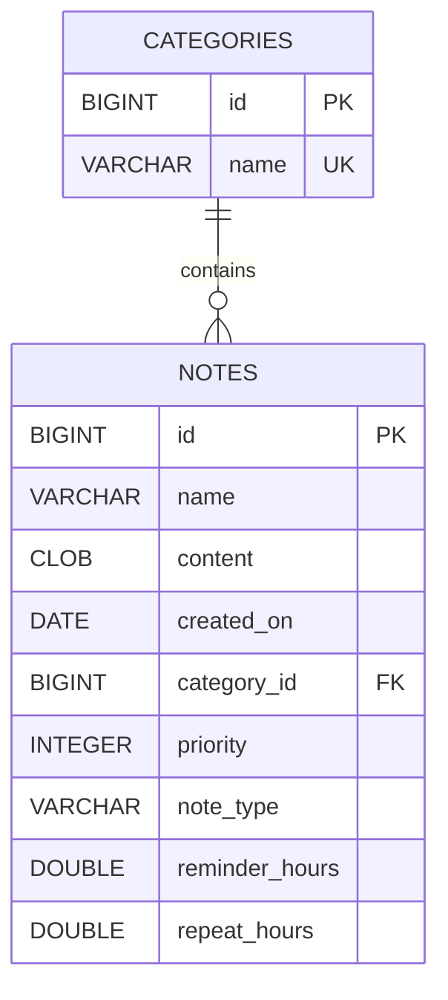

# Personal Notes — ЛР №10: Maven та JDBC

> Це документація попередньої лабораторної з гілки `lr10/maven-jdbc`. У гілці `lr11/hibernate-notes` обидві реалізації доступні разом: для JDBC-демо явно передайте `-Dexec.mainClass=com.eugene.notesapp.JdbcDemo`, для меню JDBC додайте `-Dnotes.storage=jdbc`. Типовий `exec:java` у новій гілці запускає HibernateDemo; актуальні залежності дивіться в кореневому README.

**Високий рівень (1–3).** Заміна сховища нотаток у пам'яті з ЛР №7 на файлову реляційну БД H2. Збережено інтерфейси `CRUDService<T>` і `NoteService`, наявне меню, експорт та Observer. Гілка: `lr10/maven-jdbc`; PR у `main`.

## Запуск з нуля

Потрібна **повна JDK 25 або новіша**: попередні лабораторні використовують `java.lang.IO`. Перевірте `java -version` і `javac -version`. `JAVA_HOME` має вказувати на каталог JDK, а не на `bin`. Для першого запуску потрібен інтернет для завантаження Maven і залежностей.

```powershell
git clone https://github.com/YevheniyDeriy/Java-course.git
cd Java-course
git switch lr10/maven-jdbc
.\mvnw.cmd compile
.\mvnw.cmd exec:java
.\mvnw.cmd test
```

На Linux/macOS ті самі команди через `./mvnw`. Wrapper завантажує Maven **3.9.11**, перевіряє SHA-256 дистрибутива і кешує його в `~/.m2/wrapper`; глобальний Maven встановлювати не потрібно. За наявності Maven звичайні `mvn compile`, `mvn exec:java` та `mvn test` також працюють. UTF-8 задано в `pom.xml` і `.mvn/jvm.config`.

Типовий `exec:java` запускає **JdbcDemo без введення**: CRUD, сортування SQL, пагінація, безпечна спроба SQL-ін'єкції, ROLLBACK і COMMIT. Наприкінці друкується `PASS`. Демо видаляє лише створені ним записи. Для роботи зі своїми постійними нотатками запустіть меню:

```powershell
.\mvnw.cmd exec:java '-Dexec.mainClass=com.eugene.notesapp.Main'
```

БД автоматично створюється у `data/notes.mv.db` відносно робочого каталогу; окремий сервер, SQL-консоль чи ручне створення БД не потрібні. При старті `DBConnection` читає `application.properties` і виконує `init.sql` з classpath. Усі DDL-команди мають `IF NOT EXISTS`; повторний запуск зберігає наявні дані без дублів. Скрипт не містить початкових INSERT. `mvn clean` видаляє лише `target/`, збережені нотатки залишаються.

### Налаштування

`src/main/resources/application.properties`:

```properties
db.url=jdbc:h2:file:./data/notes
db.user=sa
db.password=
db.poolSize=4
```

`jdbc` — протокол JDBC, `h2` — драйвер, `file` — файловий режим, `./data/notes` — шлях без розширення. Порожній пароль у репозиторії — типовий параметр локальної навчальної БД. Власні реквізити передавайте через оточення, яке має пріоритет над properties:

```powershell
$env:NOTES_DB_URL = 'jdbc:h2:file:./data/my-notes'
$env:NOTES_DB_USER = 'student'
$env:NOTES_DB_PASSWORD = 'local-password'
.\mvnw.cmd exec:java
```

Нові реквізити застосовуються при створенні нової БД; вони не змінюють пароль уже створеного файлу. Не комітьте справжні паролі й файли БД. `data/`, `*.mv.db`, `*.trace.db`, `target/` виключено через `.gitignore`.

Якщо встановлена урізана або пошкоджена JDK і `javac --release 25` повідомляє `release version 25 not supported`, виберіть повну JDK 25 через `JAVA_HOME`. Перевірка цієї роботи виконувалася на Temurin 25.0.5, без зміни системної Java.

## Сутності та схема БД

Нотатка має назву, текст, дату створення, категорію та пріоритет 1–5. `TextNote`, `ReminderNote`, `RecurringReminderNote` зберігаються в одній таблиці з дискримінатором `note_type`; під час читання відновлюються конкретний Java-тип, дата, час нагадування й інтервал повторення. Кількість слів обчислюється з тексту.



| Таблиця | Обмеження та призначення |
| --- | --- |
| `categories` | `id` — додатний сурогатний PK; `name` — NOT NULL, UNIQUE, непорожня після TRIM |
| `notes` | додатний PK; усі поля NOT NULL; `priority` CHECK 1..5; допустимі типи TEXT/REMINDER/RECURRING |
| `notes.category_id` | FK → `categories.id`, зв'язок багато до одного, **ON DELETE RESTRICT** |
| `reminder_hours`, `repeat_hours` | CHECK невід'ємності та узгодження з типом: TEXT 0/0; REMINDER >0/0; RECURRING >0/>0 |

`RESTRICT` захищає нотатки від випадкового видалення разом із категорією: спочатку їх потрібно перенести або видалити. Транзакційне перенесення реалізоване нижче. Зміна назви категорії автоматично видима в нотатках через JOIN.

Грошових полів у предметній області немає. `DOUBLE PRECISION` використано для тривалості у годинах відповідно до наявного Java API `double`; для грошей потрібно `NUMERIC/DECIMAL` та `BigDecimal`.

Індекси: `idx_notes_category(category_id)` для JOIN/перенесення; `idx_notes_name_priority(name, priority, id)` для сортування. UNIQUE назви категорії також індексується. Індекси прискорюють читання, але потребують місця й оновлення при записі; план запиту визначає оптимізатор H2.

## Архітектура і сумісність із ЛР №7

```text
src/main/java/com/eugene/notesapp/
  Main, JdbcDemo, BatchBenchmark
  db/DBConnection, JdbcTransaction
  model/BaseEntity, Category, Note та підкласи
  service/CRUDService, NoteService                  ← незмінні інтерфейси
  service/InMemoryCrudService, InMemoryNoteService  ← попередня реалізація
  service/AbstractJdbcCrudService                  ← Template Method
  service/JdbcNoteService, JdbcCategoryService
  exception/DataAccessException, EntityNotFoundException
  ui/, export/, observer/, util/
src/main/resources/application.properties, init.sql
src/test/java/com/eugene/notesapp/CrudServiceTest, JdbcServiceTest
```

У `Main` замінено створення `InMemoryNoteService` на `JdbcNoteService`, додано читання збереженого стану при старті та закриття пулу при виході. Виклики CRUD в меню залишилися тими самими. `JdbcDemo` використовує посилання `NoteService`, тож клієнт залежить від абстракції. Старе демо колекцій можна запустити через `-Dexec.mainClass=com.eugene.notesapp.CrudDemo`.

`save(entity)` — додавання або оновлення за незмінним id через параметризований H2 `MERGE ... KEY(id)`. Оновлення може змінити тип нотатки. Категорія з рядка `Note.getCategory()` знаходиться або створюється в тій самій транзакції, що й нотатка. `findById` кидає `EntityNotFoundException`; `delete` повертає true або false. SQL-помилки загортаються в `DataAccessException` зі збереженою причиною.

Id призначає `BaseEntity`, як у ЛР №7: `save` повертає void, а id сутності незмінний. При запуску Singleton зчитує максимальний id **обох** таблиць і піднімає спільний `AtomicLong` до створення нових сутностей. Явні id використовуються для відновлення й оновлення, і теж піднімають лічильник. Автоматична генерація id розрахована на один процес застосунку; для кількох процесів потрібна послідовність БД і зміна способу створення сутностей. Через цей контракт INSERT не потребує `RETURN_GENERATED_KEYS`: для DB-generated id їх отримували б через `prepareStatement(sql, Statement.RETURN_GENERATED_KEYS)` та `getGeneratedKeys()`.

### Template Method

`AbstractJdbcCrudService<T extends BaseEntity>` задає каркас `findById`, `save`, `delete`, `findAll`, сортувань, `findPage`, `saveBatch`: відкриття ресурсів, прив'язка параметрів, виконання, читання результату, обробка помилок. Підкласи надають `selectSql`, `saveSql`, `deleteSql`, `mapRow(ResultSet)`, `setParameters(PreparedStatement, T)` і за потреби `beforeSave(Connection, T)`. Обидві JDBC-сутності побудовані через цей клас. Усі `Connection`, `PreparedStatement`, `ResultSet` закриваються через try-with-resources.

`findAllSortedByName()` та `findAllSortedByNameAndByPriority()` виконують **ORDER BY в SQL**, а id забезпечує визначений порядок при однакових значеннях. `findAll()` повертає порядок id. Колекційний варіант зберігав порядок додавання; довільний порядок рядків SQL без ORDER BY не гарантується. Довільний `Comparator<? super T>` неможливо надійно перетворити на SQL, тому сумісний `findAllSorted(comparator)` сортує отриманий список у Java. Відомі сортування використовують БД. Назви порівнюються з урахуванням регістру; українська мовна колація окремо не налаштовується.

### Singleton та пул

`DBConnection` — лінивий потокобезпечний Singleton через initialization-on-demand holder. Ініціалізація класу JVM гарантує один екземпляр без ручного double-checked locking. Singleton зберігає `HikariDataSource`, `getConnection()` щоразу позичає окреме з'єднання з пулу до 4 елементів. `Connection.close()` повертає його в пул; `DBConnection.close()` завершує весь пул. HikariCP перевіряє стан з'єднань і замінює непридатні.

Один спільний Connection небезпечний: потоки змінювали б одна одній autoCommit і стан сесії; commit одного клієнта міг би підтвердити роботу іншого; обрив зупинив би всіх. Пул розділяє з'єднання та повторно використовує їх без вартості нового підключення для кожної операції. Кожна транзакція тут працює на одному позиченому Connection. Пул скидає стан з'єднання при поверненні.

Singleton залишається глобальною залежністю й потребує явного завершення життєвого циклу. Для тестування обидва сервіси мають конструктор із `DataSource`: тести не залежать від глобального Singleton і не торкаються користувацької БД. Пул не скасовує доменні конфлікти: паралельне перше створення однакової категорії може завершитися UNIQUE-помилкою з повним rollback; автоматичний повтор такої операції не реалізовано.

## Транзакція та відкат

`JdbcCategoryService.mergeCategories(sourceId, targetId, targetName)`:

1. Перевіряє та блокує обидві категорії через `SELECT ... FOR UPDATE`.
2. Переносить нотатки через `UPDATE notes SET category_id = ? WHERE category_id = ?`.
3. Видаляє вихідну категорію.
4. Перейменовує цільову категорію.
5. Виконує `commit()`, якщо всі дії успішні.

`JdbcTransaction.run` бере одне з'єднання, виконує `setAutoCommit(false)`; при `SQLException` або `RuntimeException` викликає `rollback()`. Помилка самого rollback додається до suppressed, початкова причина зберігається. Під час транзакції не відкриваються інші з'єднання для її SQL-команд.

Демо спочатку передає назву, яка вже належить третій категорії. На кроці 4 порушується UNIQUE — **після зміни двох таблиць**. Перевірки підтверджують: вихідна категорія існує, нотатки належать їй, цільова має стару назву. Другий виклик з унікальною назвою підтверджує всі зміни. Також тестується відкат пакетної вставки з помилкою після вже виконаних 500 записів.

ACID: атомарність забезпечує commit/rollback усіх дій; узгодженість — FK/UNIQUE/CHECK; ізоляцію підтримують транзакції й блокування; довговічність — файлове сховище H2 після підтвердження, з урахуванням налаштувань запису та гарантій ОС/диска.

## SQL-ін'єкція: поганий та хороший варіант

Небезпечний приклад наведено **лише в документації**; виконуваного методу зі `Statement` в коді немає:

```java
// НЕ ВИКОРИСТОВУВАТИ: введення змінює структуру SQL.
String sql = "SELECT * FROM notes WHERE name = '" + input + "'";
try (Statement statement = connection.createStatement();
     ResultSet rows = statement.executeQuery(sql)) {
    // ...
}
```

Для `input = "' OR '1'='1' --"` утвориться:

```sql
SELECT * FROM notes WHERE name = '' OR '1'='1' --'
```

Умова істинна для всіх рядків; решта після `--` — коментар. Замість пошуку однієї назви будуть повернуті всі нотатки. Безпечний варіант у `JdbcNoteService.findByName`:

```java
return query(selectSql() + " WHERE e.name = ? ORDER BY e.id",
        statement -> statement.setString(1, name));
```

Той самий payload передається як **одне значення**, а не SQL-код: у демо 0 збігів. Тест додатково зберігає нотатку з буквально такою назвою: пошук повертає лише її. Ручне екранування залежить від діалекту й легко пропускає крайові випадки. `?` не підставляє імена таблиць/колонок або ASC/DESC; для такого вибору потрібен whitelist. У програмі всі SQL-шаблони та поля сортування — константи розробника.

## Пакетна вставка та вимірювання

`saveBatch` використовує один PreparedStatement, `addBatch`, `executeBatch` блоками по 500 та одну транзакцію для всієї колекції. `MERGE` з відсутніми id виконує вставки. Виняток відкочує й уже виконані блоки. Порожній список допустимий, null відхиляється до запису.

```powershell
.\mvnw.cmd exec:java '-Dexec.mainClass=com.eugene.notesapp.BatchBenchmark'
# Інша кількість, наприклад 10000:
.\mvnw.cmd exec:java '-Dexec.mainClass=com.eugene.notesapp.BatchBenchmark' '-Dexec.args=10000'
```

Benchmark використовує окрему тимчасову **файлову H2**, не користувацькі нотатки. 5000 нових категорій, пул 1, прогрів 500 записів для обох способів, 3 повтори зі зміною порядку запуску. Створення об'єктів, очищення й перевірка кількості не входять у час. Замір — `System.nanoTime()`. Файли після завершення прибираються.

Результат **03.11.2026**, Windows 10 x64, Temurin 25.0.5, H2 2.3.232:

| Спосіб | Повтор 1, мс | Повтор 2, мс | Повтор 3, мс | Медіана, мс |
| --- | ---: | ---: | ---: | ---: |
| `save` по одному | 577,07 | 171,20 | 197,88 | **197,88** |
| `addBatch/executeBatch` | 146,11 | 101,61 | 56,83 | **101,61** |

Співвідношення медіан: **1,95×** на користь batch у цьому запуску.

Порівнюється типовий `save` з commit для кожного запису та `saveBatch` з одним commit для всіх записів. Результат включає різницю кількості транзакцій, отримання з'єднань і підготовок запиту, тому це **не ізольований вимір лише addBatch**. Для вбудованої H2 немає мережевого обміну; на результати впливають кеші, диск, JVM і порядок запуску. Повторний запуск може дати інші цифри; прискорення не гарантується для будь-якого обсягу.

## Пагінація

`findPage(limit, offset)` виконує `ORDER BY e.name, e.id LIMIT ? OFFSET ?`. `limit` обмежено 1..1000, offset невід'ємний. Наприклад, `findPage(20, 0)` і `findPage(20, 20)` повертають перші дві сторінки. Унікальний id — додатковий ключ для визначеного порядку.

`findAll()` залишено для сумісності з ЛР №7 і малих наборів: без обмеження завантажуються всі об'єкти, витрачаються пам'ять та час. Наявне навчальне меню теж читає знімок усіх записів; новий посторінковий API призначено для великих вибірок. Великий OFFSET змушує БД пропускати багато рядків; при паралельних змінах можливі пропуски/повтори між сторінками. Для масштабування краще keyset-пагінація за останніми `(name, id)` і визначена політика узгодженості.

## Перевірка

```powershell
.\mvnw.cmd clean verify
.\mvnw.cmd exec:java
.\mvnw.cmd dependency:tree
```

JUnit запускається автоматично в Maven. `CrudServiceTest` перевіряє попередній контракт на колекціях. `JdbcServiceTest` перевіряє CRUD і зміну типу, всі підтипи та історичні дати, Unicode, ORDER BY, межі пагінації, ін'єкцію як дані, повторну ініціалізацію, RESTRICT, перейменування категорії, commit/rollback між таблицями, атомарність save і batch, FK/CHECK, збереження після закриття та повторного відкриття файлового пулу. H2 in-memory ізольована для кожного тесту; окрема перевірка використовує тимчасовий файл.

Локальна перевірка 03.11.2026 на Temurin 25.0.5: `clean verify` — **13 тестів, 0 помилок**, `exec:java` — **PASS**. Окремо меню запущено в трьох JVM: перші дві додали по нотатці до однієї тимчасової файлової БД, третя побачила обидві; після перезапуску id не зіткнулися й перший запис не перезаписався.

Основна СУБД і тестова — H2 однієї версії; відрізняються життєвий цикл і дисковий запис. Для PostgreSQL/MySQL потрібно змінити драйвер, URL та H2-специфічний `MERGE ... KEY`, перевірити CLOB, типи й блокування. Успішні тести H2 не доводять сумісність з іншою СУБД. GitHub Actions запускає `verify` і демо на Java 25.

## Maven і JDBC — нотатки для захисту

- GAV проєкту: `com.eugene:personal-notes:1.0.0`. Драйвер: `com.h2database:h2:2.3.232`, scope **runtime** — код імпортує лише `java.sql`. Пул: `com.zaxxer:HikariCP:6.3.0`, scope compile. JUnit: test.
- Maven сам завантажує JAR та транзитивні залежності, формує classpath. Приклад транзитивної залежності: `HikariCP → slf4j-api:1.7.36`; `slf4j-simple:1.7.36` — сумісна runtime-реалізація логування. `dependency:tree` показує дерево.
- `compile` компілює основний код; `test` також компілює й виконує тести; `package` проходить validate → compile → test → package з проміжними фазами resources/testCompile і створює JAR у target; `install` додатково кладе артефакт у локальний `~/.m2/repository`. Звичайний JAR не містить залежностей; тут запуск через `exec:java`.
- `maven.compiler.release=25` фіксує доступні API й формат bytecode, UTF-8 захищає кирилицю від платформного кодування. `target/` — відтворюваний результат, тому він не комітиться.
- JDBC читання: Connection → prepareStatement → параметри → executeQuery → ResultSet.next → mapRow → автоматичне закриття у зворотному порядку. Курсор спочатку перед першим рядком. `executeQuery` повертає ResultSet, `executeUpdate` — кількість змінених рядків, `execute` — ознаку першого результату (ResultSet чи update count).
- `getInt` для SQL NULL повертає 0; для розрізнення потрібен `wasNull()` або `getObject(..., Integer.class)`. У нашій схемі обов'язкові поля NOT NULL.
- JDBC-драйвер реалізує стандартні інтерфейси під конкретний протокол БД; сервіси працюють через Connection/PreparedStatement/ResultSet. Параметри відокремлюють SQL від даних; повторне використання PreparedStatement зручне для batch.
- SQL і транзакції розташовані в `db/` та JDBC-сервісах; меню не будує запитів. Абстракції сервісів дозволили змінити спосіб зберігання без зміни їхніх інтерфейсів.

Синтаксис H2 `MERGE`, `IF NOT EXISTS`, `LIMIT/OFFSET` звірено з [офіційною документацією команд H2](https://h2database.github.io/html/commands.html).

Дата першої пари в умові не вказана; дедлайн — два тижні від неї. Дату здачі слід звірити зі своїм розкладом.
